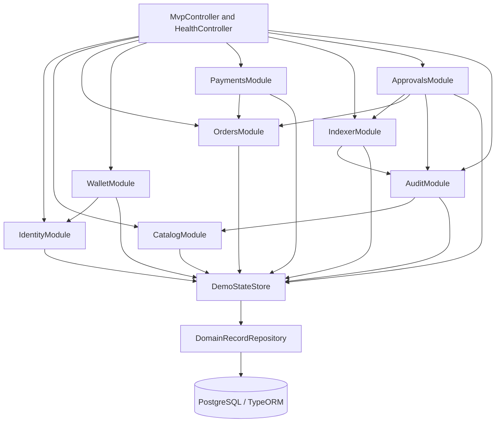

# MVP server implementation status

Updated: 2026-11-21. Scope: `MVP-SERVER-001` through `MVP-SERVER-012` only. Phase 2 remains out of scope.

`Complete in branch` means the server implementation and local verification for that task are present. It does not mean a PR has been reviewed or merged. `Pending` tasks retain their completed server-side pieces and list the work required before their acceptance criteria can be closed.

| Task | Status | Current state | Needed to close |
| --- | --- | --- | --- |
| MVP-SERVER-001 | Pending | API v1, error/state contracts, OpenAPI JSON, selected demo policy, and integration version `cobusiness-mvp-v1` documented. | Document the remaining cancellation/threshold decisions; get cross-repository approval and confirm that Web, Server, and Web3 reference this exact version. |
| MVP-SERVER-002 | Complete in branch | Validated config, PostgreSQL Compose service, TypeORM migration, readiness probe, CI workflow, and local migration checks are present. | CI run on the remote repository and PR review. |
| MVP-SERVER-003 | Pending | Fictional demo sessions, roles, `/me`, and clearly simulated KYC exist; demo token issuance and acceptance are disabled when `NODE_ENV=production`. | Replace demo authentication with Google OIDC, persistent users and sessions, secure cookies, logout and server-assigned roles; remove simulated KYC from real-user responses and verify separate CoBusiness on-chain authorization. |
| MVP-SERVER-004 | Complete in branch | Fictional operator/product data and read APIs are implemented and documented as simulated. | PR review. |
| MVP-SERVER-005 | Pending | Seeded block lot, integer pricing, terms version/hash, deadline, and fixture-confirmed progress are implemented. The hash currently uses `JSON.stringify`, so the cross-language canonicalization rule is not yet agreed. | Specify canonical terms serialization, approve the escrow ABI, and pass a real Testnet funding integration test. |
| MVP-SERVER-006 | Complete in branch | Whole-block orders, exact minor-unit totals, terms binding, idempotent sequential retries, capacity checks, and individual pending receipts are implemented and covered by unit tests. | PR review. The current order and idempotency records are saved in separate operations; atomic persistence across process failure or multiple server instances is not guaranteed. |
| MVP-SERVER-007 | Pending | Challenge lifecycle, network binding, replay/expiry checks, wallet uniqueness, revocation, and an injectable verifier boundary are implemented. | Add and configure the Stellar signature verifier; verify valid and invalid Testnet signatures. |
| MVP-SERVER-008 | Pending | Stellar SDK contribution simulation and persisted intents are implemented. Funding preparation is disabled until a verified per-offer deployment binding exists; a matching configured hash alone is insufficient. | Attest escrow-v2 and verify its terms, asset and immutable per-offer association against RPC before enabling funding. Connect the wallet signer/submission flow and pass producer/consumer Testnet tests. |
| MVP-SERVER-009 | Pending | Confirmed fixture ingestion, canonical event deduplication, integer/cap validation, and in-memory escrow projections are implemented. A migration creates a checkpoint table, but no reader uses it. Event and projection writes are not transactional; lag is hard-coded to zero and health to true. | Implement the RPC reader and persistent cursor, atomic event/projection updates, finality/recovery, contract balance reconciliation, real sync health, and producer/consumer tests. |
| MVP-SERVER-010 | Pending | Operator response, CoBusiness-only unsigned release preparation, refund preparation, and a document gated on a confirmed release event are implemented. | Verify event and authorization behavior against the deployed contract on Testnet. |
| MVP-SERVER-011 | Pending | Refund eligibility, confirmed enablement-event state, repeatable unsigned claim preparation, and fixture-refund tracking are implemented. No claim is submitted or checked against a deployed contract. | Require a confirmed contribution for each claim, then verify cause, enablement, and individual claim behavior against the deployed contract on Testnet. |
| MVP-SERVER-012 | Pending | Admin audit is read-only and returns event references; fixture ingestion has separate token protection. `syncErrors` and discrepancies are currently empty collections rather than computed telemetry. | Populate lag/error/discrepancy telemetry from the real indexer and verify production log sensitivity. |

## Architecture

The HTTP controller delegates to feature services. Feature modules are separate and have an acyclic dependency direction. Shared demo state lives in `core`; TypeORM access is isolated behind the repository in `database`. The API envelope, validation, error filter, and Swagger setup remain at the application boundary.

The domain services own the rules for their feature. `DemoStateStore` owns shared in-process records; `DomainRecordRepository` owns database access. There are no service-to-controller or circular module dependencies. The shared record table is an MVP persistence boundary; replacing it with normalized domain tables remains a production-hardening task.

## Verification performed

- `npm run build`
- `npm run typecheck`
- `npm run lint`
- `npm test`
- `npm run test:e2e` against local PostgreSQL
- `npm run migration:run` and `npm run migration:show`
- Readiness endpoint and generated OpenAPI JSON smoke checks
- `git diff --check`

## PR status

The implementation is on local branch `feature/mvp-server-mvp`. The approved plan targets `develop`, but the remote repository has no `origin/develop` branch and GitHub reports `main` as the default branch. No PR was opened against a different base without direction from the project owner.

## Code review conclusion

The three tasks marked complete in this branch have matching local acceptance evidence: PostgreSQL bootstrap/migration/readiness (002), fictional catalog/operator reads (004), and whole-block order/retry/receipt behavior (006). Task 006's idempotency is reliable for sequential retries within the current single-process demo, but not transactionally guaranteed across a crash or multiple instances.

The other nine are correctly marked pending against the backlog's full acceptance criteria. Their server-side skeletons and fixtures are present, but they still lack cross-repository contract approval, a live wallet verifier, the approved deployed ABI, a production-capable event reader/reconciler, Testnet authorization/refund evidence, or real indexer telemetry. The fixture paths do not satisfy the backlog's explicit cross-repository/Testnet integration criteria.
