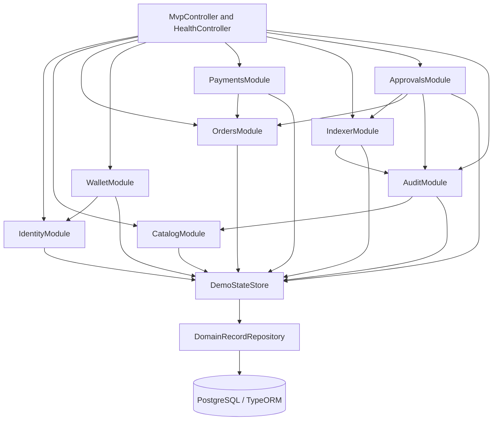

# MVP server implementation status

Updated: 2026-11-22. Escrow, payments and refunds are deferred to phase 2; reservations do not collect or confirm funds. Scope: `MVP-SERVER-001` through `MVP-SERVER-012` only. Phase 2 remains out of scope.

`Complete in branch` means the server implementation and local verification for that task are present. It does not mean a PR has been reviewed or merged. `Pending` tasks retain their completed server-side pieces and list the work required before their acceptance criteria can be closed.

| Task | Status | Current state | Needed to close |
| --- | --- | --- | --- |
| MVP-SERVER-001 | Pending | API v1, error/state contracts, OpenAPI JSON, selected demo policy, and integration version `cobusiness-mvp-v1` documented. | Document the remaining cancellation/threshold decisions; get cross-repository approval and confirm that Web, Server, and Web3 reference this exact version. |
| MVP-SERVER-002 | Complete in branch | Validated config, PostgreSQL Compose service, TypeORM migration, readiness probe, CI workflow, and local migration checks are present. | CI run on the remote repository and PR review. |
| MVP-SERVER-003 | Implemented | Email/password identity and persistent sessions replace Google sign-in. | Validate the complete web flow. |
| MVP-SERVER-004 | Complete in branch | Fictional operator/product data and read APIs are implemented and documented as simulated. | PR review. |
| MVP-SERVER-005 | Deferred to phase 2 | Escrow binding implemented; full Testnet acceptance remains. | Resume with escrow integration. |
| MVP-SERVER-006 | Complete in branch | PostgreSQL reservations atomically enforce per-offer capacity and buyer idempotency across instances; receipts remain pending. Existing orders are migrated. | Review and apply migration. |
| MVP-SERVER-007 | In progress | PostgreSQL-backed challenge and exclusive ownership with SEP-53 verification, replay protection and revocation; concurrency covered by integration tests. | Validate interoperability with the chosen browser wallet before closing. |
| MVP-SERVER-008 | Deferred to phase 2 | Payment preparation exists partially. | Complete escrow payment integration. |
| MVP-SERVER-009 | Deferred to phase 2 | Fixture event ingestion exists. | Implement confirmed RPC indexing and reconciliation. |
| MVP-SERVER-010 | Deferred to phase 2 | Partial release preparation exists. | Verify settlement against escrow. |
| MVP-SERVER-011 | Deferred to phase 2 | Partial refund preparation exists. | Complete confirmed individual refund flow. |
| MVP-SERVER-012 | Deferred to phase 2 | Fixture audit exists. | Add real chain reconciliation telemetry. |

## Architecture

The HTTP controller delegates to feature services. Feature modules are separate and have an acyclic dependency direction. Shared demo state lives in `core`; TypeORM access is isolated behind the repository in `database`. The API envelope, validation, error filter, and Swagger setup remain at the application boundary.

The domain services own the rules for their feature. `DemoStateStore` owns shared in-process records; `DomainRecordRepository` owns database access. There are no service-to-controller or circular module dependencies. The shared record table is an MVP persistence boundary; replacing it with normalized domain tables remains a production-hardening task.

## Verification performed

- `npm run build`
- `npm run typecheck`
- `npm run lint`
- `npm test`
- `npm run test:e2e` against local PostgreSQL
- `npm run migration:run` and `npm run migration:show`
- Readiness endpoint and generated OpenAPI JSON smoke checks
- `git diff --check`

## PR status

The implementation is on local branch `feature/mvp-server-mvp`. The approved plan targets `develop`, but the remote repository has no `origin/develop` branch and GitHub reports `main` as the default branch. No PR was opened against a different base without direction from the project owner.

## Revised MVP scope

Reservations are not payments. MVP-INT-001, MVP-SERVER-005, MVP-SERVER-008 through MVP-SERVER-012, and their escrow funding, release, refund and reconciliation journeys in MVP-WEB and MVP-INT-002 are deferred to phase 2. The current MVP integration covers identity, catalog, and durable reservations only; wallet interoperability remains independently pending. Historical financial routes are not acceptance evidence for this MVP.
