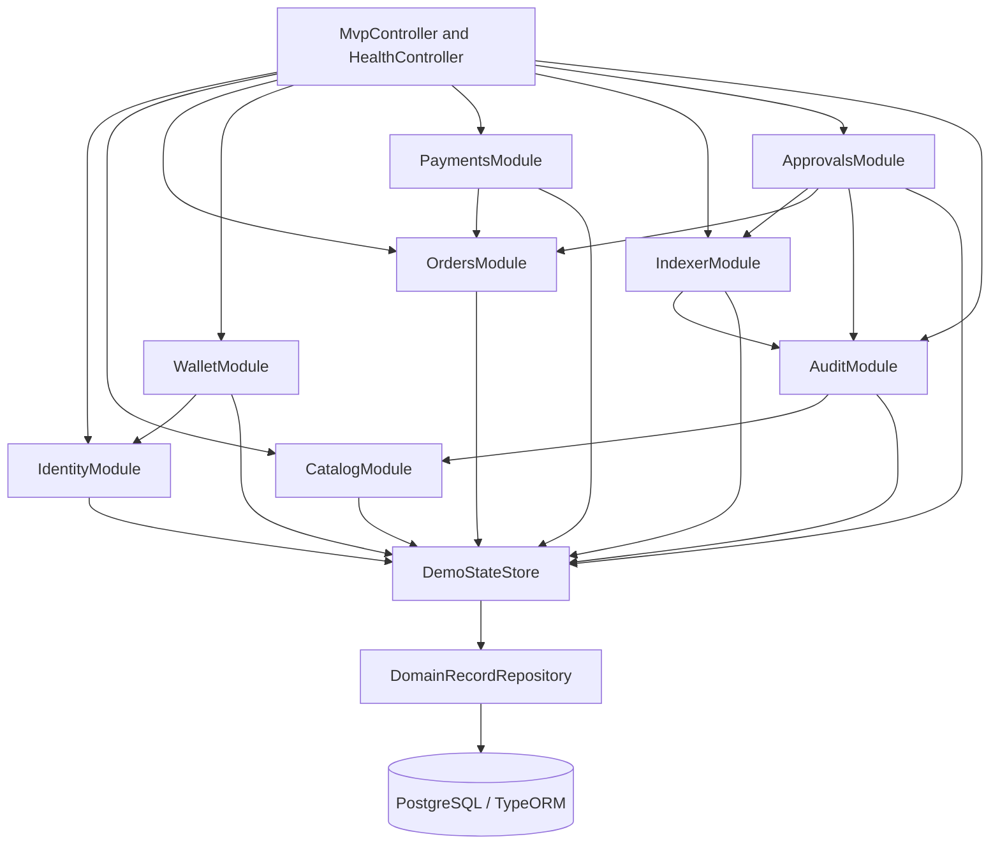

# MVP server implementation status

Updated: 2026-11-21. Scope: `MVP-SERVER-001` through `MVP-SERVER-012` only. Phase 2 remains out of scope.

`Complete in branch` means the server implementation and local verification for that task are present. It does not mean a PR has been reviewed or merged. `Pending` tasks retain their completed server-side pieces and list the work required before their acceptance criteria can be closed.

| Task | Status | Current state | Needed to close |
| --- | --- | --- | --- |
| MVP-SERVER-001 | Pending | API v1, error/state contracts, OpenAPI JSON, selected demo policy, and integration version `cobusiness-mvp-v1` documented. | Cross-repository approval and confirmation that the Web, Server, and Web3 contracts all reference this version. |
| MVP-SERVER-002 | Complete in branch | Validated config, PostgreSQL Compose service, TypeORM migration, readiness probe, CI workflow, and local migration checks are present. | CI run on the remote repository and PR review. |
| MVP-SERVER-003 | Pending | Fictional demo sessions, roles, `/me`, and clearly simulated KYC are implemented. | Verify and document the separate CoBusiness on-chain authorization with the deployed contract. |
| MVP-SERVER-004 | Complete in branch | Fictional operator/product data and read APIs are implemented and documented as simulated. | PR review. |
| MVP-SERVER-005 | Pending | Seeded block lot, integer pricing, frozen terms/hash, deadline, and confirmed-only progress are implemented. | Approved escrow ABI and real Testnet funding integration test. |
| MVP-SERVER-006 | Complete in branch | Whole-block orders, exact minor-unit totals, terms binding, idempotency, capacity checks, and individual receipts are implemented and covered by unit tests. | PR review. |
| MVP-SERVER-007 | Pending | Challenge lifecycle, network binding, replay/expiry checks, wallet uniqueness, revocation, and an injectable verifier boundary are implemented. | Add and configure the Stellar signature verifier; verify valid and invalid Testnet signatures. |
| MVP-SERVER-008 | Pending | Unsigned payment intent preparation and transaction references are implemented; pending/submitted remain unfunded. | Configure a verified wallet, approved ABI/deployment values, and pass producer/consumer tests against the Web3 implementation. |
| MVP-SERVER-009 | Pending | Confirmed fixture ingestion, canonical event deduplication, integer/cap validation, and escrow projections are implemented. | Implement the RPC reader, persistent cursor processing, finality/recovery, contract balance reconciliation, and real producer/consumer tests. |
| MVP-SERVER-010 | Pending | Operator response, CoBusiness-only unsigned release preparation, refund preparation, and a document gated on a confirmed release event are implemented. | Verify event and authorization behavior against the deployed contract on Testnet. |
| MVP-SERVER-011 | Pending | Refund eligibility, on-chain enablement state, repeatable individual claim preparation, and confirmed-refund tracking are implemented. | Verify the selected refund cause, enablement event, and claim behavior against the deployed contract on Testnet. |
| MVP-SERVER-012 | Pending | Admin audit is read-only and returns event references; fixture ingestion has separate token protection. | Complete lag/error/discrepancy telemetry from the real indexer and verify that production logs exclude sensitive data. |

## Architecture

The HTTP controller delegates to feature services. Feature modules are separate and have an acyclic dependency direction. Shared demo state lives in `core`; TypeORM access is isolated behind the repository in `database`. The API envelope, validation, error filter, and Swagger setup remain at the application boundary.

The domain services own the rules for their feature. `DemoStateStore` owns shared in-process records; `DomainRecordRepository` owns database access. There are no service-to-controller or circular module dependencies. The shared record table is an MVP persistence boundary; replacing it with normalized domain tables remains a production-hardening task.

## Verification performed

- `npm run build`
- `npm run typecheck`
- `npm run lint`
- `npm test`
- `npm run test:e2e` against local PostgreSQL
- `npm run migration:run` and `npm run migration:show`
- Readiness endpoint and generated OpenAPI JSON smoke checks
- `git diff --check`

## PR status

The implementation is on local branch `feature/mvp-server-mvp`. The approved plan targets `develop`, but the remote repository has no `origin/develop` branch and GitHub reports `main` as the default branch. No PR was opened against a different base without direction from the project owner.
